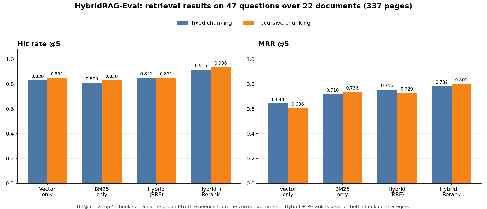
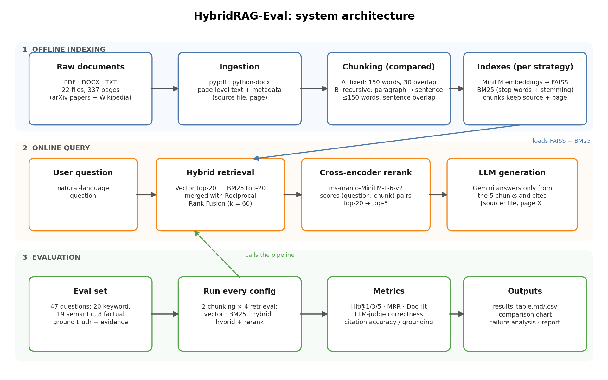

# HybridRAG-Eval

**Hybrid retrieval-augmented generation with reranking, cited answers and a reproducible evaluation benchmark.**

   



## Overview

HybridRAG-Eval is a question-answering system over a corpus of 22 documents (PDF, DOCX and TXT, 337 pages). It combines **BM25 keyword search** and **FAISS vector search**, merges them with **Reciprocal Rank Fusion**, re-scores the candidates with a **cross-encoder reranker**, and asks an LLM to answer **only from the retrieved passages, citing the source file and page** for every statement.

The project is also an evaluation harness. A 47-question benchmark measures retrieval quality (Hit@k, MRR) and answer quality (LLM-judge correctness, citation accuracy), and compares **two chunking strategies** across four retrieval configurations.

## Key features

- Page-aware ingestion of PDF, DOCX and TXT files, so every chunk keeps `source` and `page` metadata
- Two chunking strategies with the same size budget: **fixed-size** (sliding window) and **recursive** (paragraph, then sentence, then word)
- Vector search (`all-MiniLM-L6-v2` + FAISS), keyword search (BM25 with stop-words and stemming) and hybrid fusion (RRF)
- Cross-encoder reranking (`ms-marco-MiniLM-L-6-v2`): top 20 candidates to top 5
- Answers with enforced citations in the form `[source: file, page X]`, and an explicit `Not found in documents.` fallback
- Evaluation: Hit@1/3/5, MRR, document-level hit rate, LLM-judge correctness, embedding similarity, citation accuracy and citation grounding
- Provider-agnostic LLM layer: Gemini by default, or any OpenAI-compatible API (Groq, OpenRouter, Ollama) with an optional separate judge model
- Resumable answer evaluation (results are cached, so a run interrupted by an API quota can continue later)

## Architecture



1. **Indexing (offline):** documents are loaded page by page, chunked with each strategy, embedded and indexed (FAISS for vectors, BM25 for keywords).
2. **Query (online):** the question is searched by both retrievers, the two rankings are fused with RRF (k = 60), the top 20 candidates are reranked by the cross-encoder, and the best 5 chunks go to the LLM.
3. **Evaluation:** every configuration (2 chunking strategies x 4 retrieval modes) is run against the benchmark and summarised in tables and charts.

## Corpus and evaluation set

| Item | Details |
|---|---|
| Documents | 22 files: 10 PDF (arXiv papers), 6 TXT and 6 DOCX (Wikipedia articles), 337 pages |
| Topic | Machine learning and information retrieval (Transformer, BERT, RAG, ResNet, LoRA, Adam, batch normalization, word2vec, dropout, DPR, plus general ML articles) |
| Chunks | `fixed`: 1403 chunks, 136 words on average. `recursive`: 1403 chunks, 126 words on average |
| Questions | 47: 20 keyword-style, 19 semantic, 8 factual, each with a ground-truth answer, source document and evidence phrases |
| Relevance rule | A retrieved chunk is a hit if it comes from a ground-truth document **and** contains at least one evidence phrase. This works for any chunking strategy |

TXT and DOCX files have no real pages, so paragraphs are grouped into pseudo-pages of about 3000 characters. For these files "page X" in a citation means "section X".

## Project structure

```
HybridRAG-Eval/
├── data/
│   ├── raw_docs/                 # the 22 source documents
│   ├── processed/                # extracted page records (documents.json)
│   └── indexes/                  # FAISS + BM25 indexes per chunking strategy
├── scripts/
│   └── download_corpus.py        # downloads the arXiv PDFs and Wikipedia TXT/DOCX files
├── src/
│   ├── config.py                 # paths, models, chunk sizes, retrieval settings, LLM settings
│   ├── ingestion.py              # PDF / DOCX / TXT loaders
│   ├── chunking.py               # fixed and recursive chunking
│   ├── embeddings.py             # sentence-transformer embeddings
│   ├── vector_store.py           # FAISS index
│   ├── keyword_search.py         # BM25 index
│   ├── hybrid_retriever.py       # vector / BM25 / RRF hybrid retrieval
│   ├── reranker.py               # cross-encoder reranking
│   ├── llm.py                    # Gemini / OpenAI-compatible client with retry handling
│   ├── generator.py              # cited answer generation
│   ├── indexing.py               # builds and loads the indexes
│   └── pipeline.py               # end-to-end RAG pipeline and CLI
├── evaluation/
│   ├── eval_set.json             # 47 question-answer pairs
│   ├── validate_eval_set.py      # checks evidence phrases against the corpus
│   ├── metrics.py                # Hit@k, MRR, judge, citation metrics
│   ├── run_evaluation.py         # runs all configurations and writes the results
│   ├── failure_analysis.py       # explains retrieval misses and chunking differences
│   └── results/                  # tables, chart, per-question CSVs, answers
├── docs/                         # README images
├── report.md                     # experiment report
├── requirements.txt
└── README.md
```

## Setup

```bash
# 1. Environment (Python 3.10 or 3.11)
python -m venv venv
venv\Scripts\activate            # Windows
# source venv/bin/activate       # Linux / macOS

# 2. Dependencies
pip install -r requirements.txt

# 3. API key: copy .env.example to .env and fill in your key
#    GEMINI_API_KEY=...
#    GEMINI_MODEL=gemini-3.5-flash

# 4. Corpus (skip if data/raw_docs already has the 22 files)
python scripts/download_corpus.py
```

The embedding and reranker models are downloaded from Hugging Face on first use (an internet connection is required).

## Usage

Run all commands from the project root.

```bash
python -m src.indexing                               # 1. ingest, chunk and index (both strategies)
python -m evaluation.validate_eval_set               # 2. check the evaluation set against the corpus
python -m evaluation.run_evaluation --skip-answers   # 3. retrieval metrics only (no LLM calls)
python -m evaluation.run_evaluation --max-questions 5   # 4. retrieval + answer quality on N questions
python -m evaluation.failure_analysis                # 5. explain misses and chunking differences

# Ask a single question
python -m src.pipeline -q "How many attention heads does the Transformer use?"
```

Useful flags for `run_evaluation`: `--max-questions N`, `--sleep SECONDS` (pause between LLM calls), `--fresh` (ignore cached answers), `--strategies fixed recursive`.

### Using another LLM provider

Gemini is the default. To use Groq, OpenRouter or a local Ollama model, set `LLM_PROVIDER=openai`, `LLM_BASE_URL`, `LLM_API_KEY` and `LLM_MODEL` in `.env` (examples are in `.env.example`). A different model can act as judge through the `JUDGE_*` variables, which reduces self-grading bias.

## Results

### Retrieval quality (47 questions, all configurations)

| Chunking | Retrieval | Hit@1 | Hit@3 | Hit@5 | DocHit@5 | MRR@5 |
|---|---|---|---|---|---|---|
| fixed | Vector only | 0.511 | 0.787 | 0.830 | 0.979 | 0.644 |
| fixed | BM25 only | 0.638 | 0.787 | 0.809 | 1.000 | 0.718 |
| fixed | Hybrid (RRF) | 0.681 | 0.830 | 0.851 | 0.979 | 0.756 |
| fixed | **Hybrid + Rerank** | 0.681 | 0.872 | 0.915 | 0.979 | 0.782 |
| recursive | Vector only | 0.447 | 0.745 | 0.851 | 0.979 | 0.606 |
| recursive | BM25 only | 0.660 | 0.809 | 0.830 | 1.000 | 0.736 |
| recursive | Hybrid (RRF) | 0.638 | 0.809 | 0.851 | 0.979 | 0.729 |
| recursive | **Hybrid + Rerank** | **0.723** | **0.894** | **0.936** | 0.979 | **0.801** |

`Hit@k`: a top-k chunk contains the ground-truth evidence from the correct document. `DocHit@k`: a top-k chunk comes from the correct document. `MRR@5`: mean reciprocal rank of the first relevant chunk in the top 5.

### Hit@5 by question type (Hybrid + Rerank)

| Chunking | Factual (8) | Keyword (20) | Semantic (19) |
|---|---|---|---|
| fixed | 0.875 | 0.950 | 0.895 |
| recursive | 0.875 | 1.000 | 0.895 |

### Answer quality (pilot: first 5 questions)

| Chunking | Correctness (LLM judge) | Answer similarity | Citation to correct source | Citations grounded in retrieved chunks |
|---|---|---|---|---|
| fixed | 1.000 | 0.724 | 0.800 | 1.000 |
| recursive | 1.000 | 0.738 | 0.800 | 1.000 |

Answer quality was measured on 5 questions only. The free Gemini API quota was exhausted when the run reached question 6 (HTTP 429, `RESOURCE_EXHAUSTED`), so these numbers are a pilot and should not be generalised. See [report.md](report.md) for details.

## Chunking comparison

Recursive chunking scored slightly higher than fixed-size chunking with the full pipeline (Hit@5 0.936 vs 0.915, MRR@5 0.801 vs 0.782). The difference is one question at Hit@5, and the two strategies each win on a similar number of individual questions (recursive 9, fixed 7, 31 ties), so the advantage is **not statistically significant** on 47 questions. The report discusses possible reasons and what would be needed to settle the question.

## Limitations

- The answer-quality evaluation covers 5 questions because of the free-tier API quota; retrieval metrics cover all 47.
- The generator and the judge were the same model (Gemini 3.5 Flash) in the pilot, which can favour the generated answers.
- The evaluation set was written for this project and not independently reviewed. Relevance is judged by evidence phrases, which can miss valid passages that word things differently.
- With 47 questions, differences of one or two questions (about 2 to 4 percentage points) are within noise.
- Chunks do not cross page boundaries, so an answer split across two pages can be cut.
- A single embedding model and a single chunk size were tested.

## Future work

- Complete the answer-quality run on all 47 questions with a higher quota or an alternative provider, and use a different model as judge
- Add bootstrap confidence intervals and a chunk-size ablation (for example 100, 150 and 250 words)
- Try a stronger embedding model and a larger evaluation set reviewed by a second person
- Expose the pipeline through a FastAPI `/ask` endpoint

## Tech stack

Python, sentence-transformers, FAISS, rank-bm25, NLTK, scikit-learn, pypdf, python-docx, Google Gemini API (`google-genai`), pandas, matplotlib.

## Author

**Muhammad Faizan Farooq**: [GitHub](https://github.com/faizanjutt473) · [LinkedIn](https://www.linkedin.com/in/muhammad-faizan-farooq-8bab35372)
